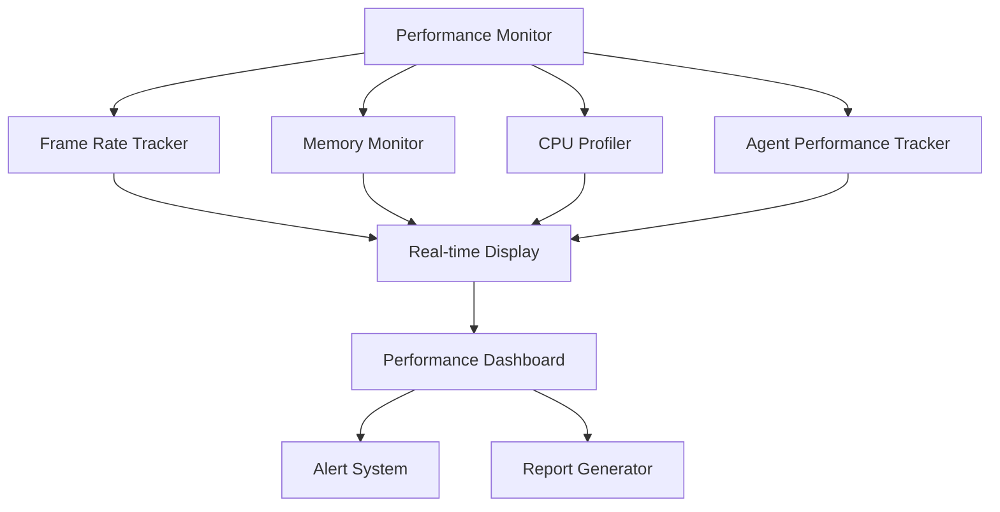
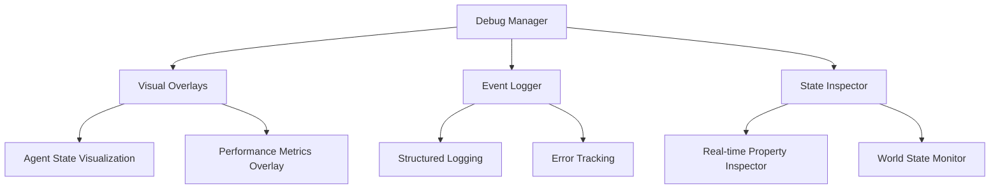

# Design Document

## Overview

This design outlines the systematic approach to updating all project dependencies, particularly the Babylon.js ecosystem from version 8.4.0 to 8.29.0, while implementing comprehensive debugging and performance benchmarking systems. The design ensures minimal disruption to existing functionality while maximizing the benefits of the latest features and improvements.

## Architecture

### Dependency Update Strategy

The update process follows a phased approach:

1. **Preparation Phase**: Backup current state and analyze breaking changes
2. **Core Update Phase**: Update Babylon.js packages in dependency order
3. **Validation Phase**: Test functionality and performance
4. **Enhancement Phase**: Implement new debugging and performance tools

### Performance Monitoring Architecture



### Debug System Architecture



## Components and Interfaces

### 1. DependencyManager

Handles the systematic update of all dependencies:

```javascript
class DependencyManager {
    async updateBabylonPackages() {
        // Update all @babylonjs/* packages to 8.29.0
    }
    
    async validateCompatibility() {
        // Test existing functionality
    }
    
    async migrateBreakingChanges() {
        // Handle API changes
    }
}
```

### 2. PerformanceMonitor

Comprehensive performance tracking system:

```javascript
class PerformanceMonitor {
    constructor() {
        this.frameRateTracker = new FrameRateTracker();
        this.memoryMonitor = new MemoryMonitor();
        this.cpuProfiler = new CPUProfiler();
        this.agentProfiler = new AgentPerformanceTracker();
    }
    
    startMonitoring() {
        // Begin performance data collection
    }
    
    generateReport() {
        // Create performance analysis report
    }
}
```

### 3. DebugSystem

Advanced debugging capabilities:

```javascript
class DebugSystem {
    constructor(scene) {
        this.visualOverlays = new VisualOverlayManager(scene);
        this.eventLogger = new StructuredLogger();
        this.stateInspector = new StateInspector();
    }
    
    enableDebugMode() {
        // Activate all debug features
    }
    
    captureSystemState() {
        // Snapshot current system state
    }
}
```

### 4. PerformanceDashboard

Real-time performance visualization:

```javascript
class PerformanceDashboard {
    constructor() {
        this.metricsDisplay = new MetricsDisplay();
        this.alertSystem = new AlertSystem();
        this.chartManager = new ChartManager();
    }
    
    updateMetrics(performanceData) {
        // Update real-time displays
    }
    
    checkThresholds(metrics) {
        // Monitor for performance issues
    }
}
```

## Data Models

### Performance Metrics

```javascript
interface PerformanceMetrics {
    timestamp: number;
    frameRate: {
        current: number;
        average: number;
        min: number;
        max: number;
    };
    memory: {
        used: number;
        total: number;
        heapUsed: number;
    };
    cpu: {
        utilization: number;
        renderTime: number;
        updateTime: number;
    };
    agents: {
        count: number;
        updateTime: number;
        averageUpdateTime: number;
    };
}
```

### Debug Event

```javascript
interface DebugEvent {
    timestamp: number;
    level: 'info' | 'warn' | 'error' | 'debug';
    category: string;
    message: string;
    context: object;
    stackTrace?: string;
}
```

### System State Snapshot

```javascript
interface SystemStateSnapshot {
    timestamp: number;
    scene: {
        meshCount: number;
        lightCount: number;
        cameraCount: number;
    };
    agents: AgentState[];
    performance: PerformanceMetrics;
    memory: MemorySnapshot;
}
```

## Error Handling

### Dependency Update Errors

1. **Version Conflicts**: Automatic resolution with fallback to compatible versions
2. **Breaking Changes**: Automated migration scripts with manual review points
3. **Test Failures**: Rollback mechanism with detailed failure reports

### Performance Monitoring Errors

1. **Data Collection Failures**: Graceful degradation with partial metrics
2. **Memory Leaks**: Automatic cleanup and alerting
3. **Performance Degradation**: Threshold-based alerts and recommendations

### Debug System Errors

1. **Overlay Rendering Issues**: Fallback to text-based debugging
2. **Log Storage Limits**: Automatic rotation and compression
3. **State Inspection Errors**: Safe property access with error boundaries

## Testing Strategy

### Dependency Update Testing

1. **Unit Tests**: Verify individual component functionality
2. **Integration Tests**: Test system interactions
3. **Performance Tests**: Compare before/after metrics
4. **Visual Tests**: Ensure rendering consistency

### Performance Monitor Testing

1. **Accuracy Tests**: Validate metric collection accuracy
2. **Load Tests**: Test under high agent counts
3. **Memory Tests**: Verify no memory leaks in monitoring
4. **UI Tests**: Test dashboard responsiveness

### Debug System Testing

1. **Overlay Tests**: Verify visual debug information accuracy
2. **Logging Tests**: Test log formatting and storage
3. **Inspector Tests**: Validate state inspection accuracy
4. **Error Handling Tests**: Test error capture and reporting

## Implementation Phases

### Phase 1: Dependency Updates
- Update package.json with new versions
- Run compatibility tests
- Fix breaking changes
- Validate existing functionality

### Phase 2: Performance Monitoring
- Implement core performance tracking
- Create real-time dashboard
- Add alerting system
- Generate performance reports

### Phase 3: Debug System
- Implement visual overlays
- Create structured logging
- Add state inspection tools
- Integrate error tracking

### Phase 4: Integration & Polish
- Integrate all systems
- Optimize performance overhead
- Add configuration options
- Create documentation