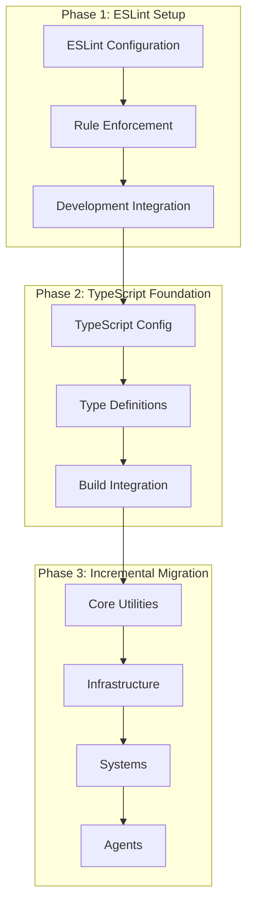

# Design Document: ESLint and TypeScript Migration

## Overview

This design outlines the implementation of strict ESLint configuration and incremental TypeScript migration for the 3D Village Simulation codebase. The approach prioritizes maintaining existing functionality while gradually introducing type safety and code quality improvements.

The migration strategy follows a phased approach: first establishing ESLint for immediate code quality benefits, then configuring TypeScript tooling, and finally converting files incrementally starting with core utilities and infrastructure before moving to complex agent systems.

## Architecture

### Migration Architecture

The migration follows a layered approach that respects the existing component-based agent architecture:



### Tool Integration Strategy

The tooling integrates with the existing pnpm-based development workflow:

- **ESLint**: Validates code quality in real-time during development
- **TypeScript Compiler**: Provides incremental compilation with source maps
- **Build System**: Maintains existing Fastify server with hot reload
- **Development Tools**: Preserves existing testing and coverage workflows

## Components and Interfaces

### ESLint Configuration Component

**Purpose**: Enforce code quality standards across JavaScript and TypeScript files

**Key Interfaces**:
```javascript
// eslint.config.js (ESLint 9+ flat config)
export default [
  {
    files: ["MyHavokSimCode/**/*.js", "MyHavokSimCode/**/*.ts"],
    languageOptions: {
      ecmaVersion: 2022,
      sourceType: "module"
    },
    rules: {
      // Strict quality rules
    }
  }
];
```

**Configuration Sections**:
- **Base Rules**: Syntax errors, potential bugs, code style
- **ES6 Module Rules**: Import/export validation and ordering
- **Complexity Rules**: Function complexity and maintainability metrics
- **TypeScript Rules**: Type-specific linting when .ts files are present

### TypeScript Configuration Component

**Purpose**: Enable gradual TypeScript adoption with strict type checking

**Key Interfaces**:
```json
// tsconfig.json
{
  "compilerOptions": {
    "target": "ES2022",
    "module": "ES2022",
    "moduleResolution": "node",
    "strict": true,
    "allowJs": true,
    "checkJs": false,
    "declaration": true,
    "sourceMap": true,
    "outDir": "./dist",
    "rootDir": "./MyHavokSimCode"
  },
  "include": ["MyHavokSimCode/**/*"],
  "exclude": ["node_modules", "dist", "coverage"]
}
```

**Configuration Features**:
- **Strict Mode**: Enables all strict type checking options
- **Mixed Support**: Allows .js and .ts files during migration
- **Source Maps**: Maintains debugging capability
- **Declaration Files**: Generates .d.ts files for converted modules

### Migration Orchestrator Component

**Purpose**: Manage the incremental conversion process and track progress

**Key Interfaces**:
```javascript
class MigrationOrchestrator {
  constructor(projectRoot, migrationConfig) {
    this.projectRoot = projectRoot;
    this.config = migrationConfig;
    this.migrationLog = new Map();
  }
  
  async convertFile(filePath) {
    // Convert .js to .ts with type annotations
  }
  
  validateDependencies(filePath) {
    // Ensure converted files don't break dependents
  }
  
  generateProgressReport() {
    // Track migration status
  }
}
```

**Migration Phases**:
1. **Core Utilities** (`MyHavokSimCode/Utilities/`, `MyHavokSimCode/core/`)
2. **Infrastructure** (`AssetManager.js`, build configuration files)
3. **Systems** (`MyHavokSimCode/systems/`, level system, performance monitoring)
4. **Agents** (`MyHavokSimCode/Agents/` - complex behavioral systems)

### Build System Integration Component

**Purpose**: Maintain existing development workflow while adding new tooling

**Key Interfaces**:
```javascript
// Enhanced package.json scripts
{
  "scripts": {
    "lint": "eslint MyHavokSimCode/",
    "lint:fix": "eslint MyHavokSimCode/ --fix",
    "type-check": "tsc --noEmit",
    "build": "tsc && npm run lint",
    "dev": "concurrently \"tsc --watch\" \"npm run start\"",
    "start": "node server.js"
  }
}
```

## Data Models

### ESLint Configuration Model

```javascript
const ESLintConfig = {
  files: ["MyHavokSimCode/**/*.{js,ts}"],
  languageOptions: {
    ecmaVersion: 2022,
    sourceType: "module",
    globals: {
      // Babylon.js globals
      BABYLON: "readonly",
      // Havok Physics globals  
      HK: "readonly"
    }
  },
  rules: {
    // Error Prevention
    "no-undef": "error",
    "no-unused-vars": "error", 
    "no-console": "warn",
    
    // Code Quality
    "complexity": ["error", 10],
    "max-depth": ["error", 4],
    "max-lines-per-function": ["error", 50],
    
    // Style Consistency
    "indent": ["error", 2],
    "quotes": ["error", "single"],
    "semi": ["error", "always"],
    
    // Import Management
    "import/order": "error",
    "import/no-unused-modules": "error"
  }
};
```

### TypeScript Configuration Model

```json
{
  "compilerOptions": {
    "target": "ES2022",
    "lib": ["ES2022", "DOM", "WebWorker"],
    "module": "ES2022", 
    "moduleResolution": "node",
    "allowSyntheticDefaultImports": true,
    "esModuleInterop": true,
    
    "strict": true,
    "noImplicitAny": true,
    "strictNullChecks": true,
    "strictFunctionTypes": true,
    "noImplicitReturns": true,
    "noFallthroughCasesInSwitch": true,
    
    "allowJs": true,
    "checkJs": false,
    "declaration": true,
    "declarationMap": true,
    "sourceMap": true,
    
    "outDir": "./dist",
    "rootDir": "./MyHavokSimCode",
    "baseUrl": "./",
    "paths": {
      "@core/*": ["MyHavokSimCode/core/*"],
      "@agents/*": ["MyHavokSimCode/Agents/*"],
      "@systems/*": ["MyHavokSimCode/systems/*"]
    }
  },
  "include": [
    "MyHavokSimCode/**/*",
    "assets/AssetManager.js"
  ],
  "exclude": [
    "node_modules",
    "dist", 
    "coverage",
    "docs"
  ]
}
```

### Migration Progress Model

```javascript
const MigrationProgress = {
  phases: {
    eslint: {
      status: "completed" | "in-progress" | "pending",
      filesProcessed: number,
      errorsFound: number,
      errorsFixed: number
    },
    typescript: {
      status: "completed" | "in-progress" | "pending", 
      configurationComplete: boolean,
      typesInstalled: boolean
    },
    fileConversion: {
      coreUtilities: {
        totalFiles: number,
        convertedFiles: number,
        files: [
          {
            path: string,
            status: "converted" | "in-progress" | "pending",
            typeErrors: number,
            dependencies: string[]
          }
        ]
      },
      infrastructure: { /* similar structure */ },
      systems: { /* similar structure */ },
      agents: { /* similar structure */ }
    }
  },
  overallProgress: {
    totalFiles: number,
    convertedFiles: number,
    percentComplete: number
  }
};
```

### Babylon.js Type Integration Model

```typescript
// Type definitions for 3D engine integration
interface BabylonTypeConfig {
  engine: {
    babylonVersion: "7.47.2",
    typesPackage: "@babylonjs/core",
    additionalTypes: ["@babylonjs/gui", "@babylonjs/loaders", "@babylonjs/materials"]
  },
  physics: {
    havokVersion: "1.3.10", 
    typesPackage: "@babylonjs/havok",
    globalTypes: {
      HK: "HavokPhysics",
      BABYLON: "BabylonJS"
    }
  },
  customTypes: {
    agentTypes: "MyHavokSimCode/types/agents.d.ts",
    systemTypes: "MyHavokSimCode/types/systems.d.ts",
    environmentTypes: "MyHavokSimCode/types/environment.d.ts"
  }
}
```

## Correctness Properties

*A property is a characteristic or behavior that should hold true across all valid executions of a system—essentially, a formal statement about what the system should do. Properties serve as the bridge between human-readable specifications and machine-verifiable correctness guarantees.*

### Property 1: ESLint Comprehensive File Processing
*For any* JavaScript or TypeScript file in the MyHavokSimCode directory, ESLint should process the file and report all syntax errors, potential bugs, and style violations according to the configured rules
**Validates: Requirements 1.1, 1.2, 1.3**

### Property 2: ESLint Actionable Output Format
*For any* linting run that finds violations, the output should contain file paths, line numbers, column numbers, rule names, and error descriptions for each violation
**Validates: Requirements 1.4**

### Property 3: Build System Lint Integration
*For any* build process where linting errors are present, the build should fail with a non-zero exit code
**Validates: Requirements 1.5**

### Property 4: TypeScript ES6 Module Preservation
*For any* TypeScript file with ES6 import/export statements, compilation should produce JavaScript that maintains the same module structure and import/export relationships
**Validates: Requirements 2.1**

### Property 5: TypeScript Strict Mode Enforcement
*For any* TypeScript code that would result in implicit any types, the compiler should report type errors when strict mode is enabled
**Validates: Requirements 2.2**

### Property 6: Mixed File Type Support
*For any* project containing both .js and .ts files, the build system should successfully compile and link all files together without import/export errors
**Validates: Requirements 2.3, 3.4**

### Property 7: Source Map Generation
*For any* TypeScript file that compiles successfully, the compiler should generate corresponding .js.map files with accurate line mappings
**Validates: Requirements 2.4**

### Property 8: Third-Party Type Recognition
*For any* import statement referencing Babylon.js or Havok Physics APIs, the TypeScript compiler should recognize the types and provide proper type checking without errors
**Validates: Requirements 2.5, 4.1, 4.2**

### Property 9: Migration Priority Ordering
*For any* file selection during migration, core utilities and infrastructure files should be selected before complex agent system files
**Validates: Requirements 3.1**

### Property 10: Post-Migration Type Validation
*For any* file converted from JavaScript to TypeScript, all function signatures and variable declarations should pass TypeScript strict type checking
**Validates: Requirements 3.3**

### Property 11: Dependency Compatibility Preservation
*For any* file that depends on a converted module, the dependent file should continue to compile and execute correctly after the dependency's conversion
**Validates: Requirements 3.5**

### Property 12: 3D Engine Type Validation
*For any* code using Babylon.js mesh creation, scene management, or Havok physics operations, the TypeScript compiler should validate the API usage and catch type errors
**Validates: Requirements 4.3, 4.5**

### Property 13: Browser API Compatibility
*For any* WebGL or WebGPU API usage in converted TypeScript files, the type system should maintain compatibility with browser rendering contexts
**Validates: Requirements 4.4**

### Property 14: Build Output Structure Preservation
*For any* TypeScript compilation, the output directory structure should match the input structure and maintain browser-loadable file organization
**Validates: Requirements 5.4**

### Property 15: Code Quality Rule Enforcement
*For any* code that violates configured style rules (indentation, semicolons, quotes, complexity, imports), ESLint should flag the violations
**Validates: Requirements 6.1, 6.2, 6.3**

### Property 16: TypeScript Strict Annotation Requirements
*For any* function in strict TypeScript mode, missing parameter types or return type annotations should result in compilation errors
**Validates: Requirements 6.4**

### Property 17: Incremental Processing Optimization
*For any* unchanged file during incremental compilation or linting, the tool should skip processing and use cached results
**Validates: Requirements 7.1, 7.2, 7.5**

### Property 18: Parallel Tool Execution
*For any* build process where both linting and type checking are required, the tools should execute concurrently when possible to minimize total build time
**Validates: Requirements 7.3**

### Property 19: Migration Progress Tracking
*For any* migration operation, the system should maintain accurate records of file conversion status, dependency relationships, and overall progress percentage
**Validates: Requirements 8.1, 8.2, 8.3**

### Property 20: Post-Migration Validation
*For any* completed module migration, all dependent modules should continue to function correctly and pass their existing tests
**Validates: Requirements 8.5**

## Error Handling

### ESLint Error Recovery
- **Configuration Errors**: Invalid ESLint configurations should provide clear error messages with specific rule or syntax issues
- **File Processing Errors**: Files that cannot be parsed should be reported with file path and parsing error details
- **Rule Conflicts**: Conflicting rules should be detected and reported during configuration validation

### TypeScript Compilation Error Management
- **Type Errors**: Type checking failures should provide precise error locations with suggested fixes
- **Module Resolution Errors**: Missing or incorrect imports should provide clear resolution guidance
- **Configuration Errors**: Invalid tsconfig.json should report specific configuration issues

### Migration Error Handling
- **Conversion Failures**: Files that cannot be automatically converted should be flagged for manual review
- **Dependency Conflicts**: Circular dependencies or type conflicts should be detected and reported
- **Build Integration Errors**: Failures in build system integration should provide rollback mechanisms

### Performance Degradation Handling
- **Build Time Monitoring**: Excessive build times should trigger warnings and suggest optimization strategies
- **Memory Usage Tracking**: High memory usage during compilation should be monitored and reported
- **Cache Invalidation**: Corrupted cache files should be automatically detected and regenerated

## Testing Strategy

### Dual Testing Approach
The testing strategy combines unit tests for specific scenarios with property-based tests for comprehensive validation:

**Unit Tests Focus**:
- Specific ESLint rule configurations and their expected outputs
- TypeScript compilation of known file patterns
- Migration tool behavior with sample file structures
- Build system integration with existing workflows
- Error handling for known failure scenarios

**Property-Based Tests Focus**:
- ESLint processing across randomly generated code samples
- TypeScript compilation with various module structures
- Migration ordering with different project layouts
- Performance characteristics under varying load conditions
- Cross-file dependency validation during migration

### Property-Based Testing Configuration
- **Testing Library**: Use `fast-check` for JavaScript/TypeScript property-based testing
- **Test Iterations**: Minimum 100 iterations per property test to ensure comprehensive coverage
- **Test Tagging**: Each property test tagged with format: **Feature: eslint-typescript-migration, Property {number}: {property_text}**

### Testing Environment Setup
- **Isolated Test Projects**: Each test creates isolated project structures to avoid interference
- **Babylon.js Test Integration**: Mock Babylon.js and Havok Physics dependencies for testing without full 3D engine
- **Build System Testing**: Use temporary directories and process spawning to test build integration
- **Performance Benchmarking**: Establish baseline performance metrics for comparison during optimization testing

### Integration Testing Strategy
- **End-to-End Migration**: Test complete migration workflows from JavaScript to TypeScript
- **Development Workflow Testing**: Validate that existing development commands continue to work
- **Cross-Platform Testing**: Ensure tooling works across different operating systems and Node.js versions
- **Regression Testing**: Maintain test suites that verify existing functionality remains intact