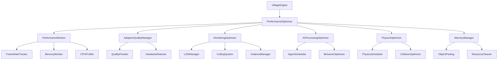

# Performance Optimization Design Document

## Overview

This design document outlines a comprehensive performance optimization system for the 3D village simulation. The system builds upon the existing performance monitoring infrastructure while adding new optimization layers including adaptive quality management, rendering optimizations, AI processing efficiency, and physics optimization.

The design follows a multi-layered approach:
1. **Performance Monitoring Layer** - Enhanced existing monitoring with real-time metrics
2. **Adaptive Quality Management** - Dynamic quality adjustment based on performance
3. **Rendering Optimization Layer** - GPU-focused optimizations (LOD, culling, instancing)
4. **AI Processing Optimization** - Efficient agent processing and behavior management
5. **Physics Optimization Layer** - Havok physics performance tuning
6. **Memory Management Layer** - Proactive memory optimization and leak prevention

## Architecture

### System Integration



### Performance Optimization Pipeline

The optimization system operates in a continuous feedback loop:
1. **Monitor** - Collect performance metrics every frame
2. **Analyze** - Evaluate performance against thresholds
3. **Decide** - Determine optimization actions needed
4. **Apply** - Execute optimizations dynamically
5. **Validate** - Measure impact and adjust

## Components and Interfaces

### 1. PerformanceOptimizer (Main Controller)

```javascript
class PerformanceOptimizer {
    constructor(engine, scene, systems)
    
    // Core methods
    initialize()
    startOptimization()
    stopOptimization()
    updateOptimizations(deltaTime)
    
    // Configuration
    setOptimizationLevel(level) // 'conservative', 'balanced', 'aggressive'
    setTargetFPS(fps)
    enableAdaptiveQuality(enabled)
    
    // Monitoring integration
    onPerformanceAlert(alert)
    getOptimizationStatus()
}
```

### 2. AdaptiveQualityManager

Manages dynamic quality adjustments based on performance metrics:

```javascript
class AdaptiveQualityManager {
    constructor(hardwareDetector, qualityPresets)
    
    // Quality management
    detectHardwareCapabilities()
    setQualityLevel(level) // 0-100 scale
    adjustQualityForPerformance(metrics)
    
    // Quality presets
    applyPreset(presetName) // 'low', 'medium', 'high', 'ultra'
    createCustomPreset(settings)
    
    // Dynamic adjustment
    enableDynamicAdjustment(enabled)
    setPerformanceTargets(targets)
}
```

### 3. RenderingOptimizer

Handles GPU and rendering optimizations:

```javascript
class RenderingOptimizer {
    constructor(scene, camera)
    
    // LOD Management
    setupLODSystem()
    updateLOD(camera, meshes)
    
    // Culling
    enableFrustumCulling(enabled)
    enableOcclusionCulling(enabled)
    
    // Instancing
    createInstancedMeshes(meshes)
    updateInstances()
    
    // Texture optimization
    optimizeTextures(quality)
    enableTextureStreaming(enabled)
}
```

### 4. AIProcessingOptimizer

Optimizes AI agent processing:

```javascript
class AIProcessingOptimizer {
    constructor(agentSystems)
    
    // Agent scheduling
    setupAgentScheduler()
    scheduleAgentUpdates(agents, deltaTime)
    
    // Distance-based optimization
    setUpdateFrequencyByDistance(agent, camera)
    
    // Behavior optimization
    optimizeBehaviorCalculations(agents)
    enableBehaviorCaching(enabled)
}
```

### 5. PhysicsOptimizer

Optimizes Havok physics performance:

```javascript
class PhysicsOptimizer {
    constructor(physicsEngine)
    
    // Physics scheduling
    setupPhysicsScheduler()
    optimizePhysicsUpdates(deltaTime)
    
    // Collision optimization
    setupSpatialPartitioning()
    optimizeCollisionDetection()
    
    // Sleep management
    manageSleepingBodies()
    optimizeActiveBodyCount()
}
```

### 6. MemoryManager

Handles memory optimization and leak prevention:

```javascript
class MemoryManager {
    constructor(scene)
    
    // Object pooling
    createObjectPool(type, initialSize)
    getPooledObject(type)
    returnToPool(object, type)
    
    // Resource cleanup
    scheduleResourceCleanup()
    disposeUnusedResources()
    
    // Memory monitoring
    trackMemoryUsage()
    detectMemoryLeaks()
}
```

## Data Models

### Performance Metrics Model

```javascript
const PerformanceMetrics = {
    timestamp: Number,
    frameRate: {
        current: Number,
        average: Number,
        min: Number,
        max: Number,
        target: Number
    },
    memory: {
        used: Number,
        total: Number,
        percentage: Number,
        trend: String // 'increasing', 'stable', 'decreasing'
    },
    rendering: {
        drawCalls: Number,
        triangles: Number,
        meshCount: Number,
        textureMemory: Number
    },
    ai: {
        activeAgents: Number,
        processingTime: Number,
        behaviorUpdates: Number
    },
    physics: {
        activeBodies: Number,
        collisionChecks: Number,
        processingTime: Number
    }
}
```

### Quality Settings Model

```javascript
const QualitySettings = {
    level: Number, // 0-100
    preset: String, // 'low', 'medium', 'high', 'ultra'
    rendering: {
        shadowQuality: Number, // 0-3
        textureQuality: Number, // 0-3
        lodDistance: Number,
        maxDrawCalls: Number,
        enableInstancing: Boolean
    },
    ai: {
        maxActiveAgents: Number,
        updateFrequency: Number,
        behaviorComplexity: Number
    },
    physics: {
        maxActiveBodies: Number,
        collisionAccuracy: Number,
        updateFrequency: Number
    },
    effects: {
        particleCount: Number,
        cloudDetail: Number,
        waterQuality: Number
    }
}
```

### Hardware Capabilities Model

```javascript
const HardwareCapabilities = {
    gpu: {
        vendor: String,
        renderer: String,
        maxTextureSize: Number,
        maxVertexAttribs: Number,
        webglVersion: String
    },
    memory: {
        available: Number,
        recommended: Number
    },
    performance: {
        estimatedTier: String, // 'low', 'medium', 'high'
        recommendedQuality: String,
        maxExpectedFPS: Number
    }
}
```

## Error Handling

### Performance Degradation Recovery

1. **Graceful Degradation**: Automatically reduce quality when performance drops
2. **Emergency Mode**: Minimal quality settings when critical thresholds are hit
3. **Recovery Detection**: Gradually increase quality when performance improves
4. **User Override Protection**: Prevent settings that would cause poor performance

### Error Recovery Strategies

```javascript
const ErrorRecoveryStrategies = {
    MEMORY_PRESSURE: {
        actions: ['disposeUnusedResources', 'reduceTextureQuality', 'limitAgentCount'],
        priority: 'high'
    },
    LOW_FRAMERATE: {
        actions: ['reduceLODDistance', 'disableNonEssentialEffects', 'limitPhysicsUpdates'],
        priority: 'medium'
    },
    GPU_OVERLOAD: {
        actions: ['reduceDrawCalls', 'disableInstancing', 'lowerShadowQuality'],
        priority: 'high'
    }
}
```

## Testing Strategy

### Performance Testing Framework

1. **Automated Performance Tests**
   - Frame rate consistency tests across different scenarios
   - Memory usage growth tests over extended periods
   - Stress tests with maximum agent counts
   - Quality transition smoothness tests

2. **Benchmark Scenarios**
   - Baseline performance with minimal scene
   - Village scenario with full systems active
   - Coastal scenario with water and fish
   - Stress scenario with maximum complexity

3. **Hardware Compatibility Testing**
   - Low-end hardware simulation
   - Mid-range hardware validation
   - High-end hardware optimization verification

### Performance Metrics Validation

```javascript
const PerformanceTestSuite = {
    frameRateConsistency: {
        minFPS: 30,
        targetFPS: 60,
        maxFrameTimeVariance: 5, // ms
        testDuration: 300000 // 5 minutes
    },
    memoryStability: {
        maxGrowthRate: 1048576, // 1MB/s
        maxTotalUsage: 536870912, // 512MB
        testDuration: 1800000 // 30 minutes
    },
    qualityTransitions: {
        maxTransitionTime: 1000, // 1 second
        smoothnessThreshold: 0.95,
        testAllPresets: true
    }
}
```

### Integration Testing

1. **System Integration Tests**
   - Verify all optimization systems work together
   - Test performance monitoring integration
   - Validate quality adjustment responsiveness

2. **Regression Testing**
   - Ensure optimizations don't break existing functionality
   - Verify visual quality is maintained at each level
   - Test backward compatibility with existing saves/settings

### Load Testing

1. **Agent Scaling Tests**
   - Test performance with 10, 50, 100, 200+ agents
   - Measure optimization effectiveness at each scale
   - Validate graceful degradation

2. **Extended Runtime Tests**
   - 24-hour continuous operation tests
   - Memory leak detection over time
   - Performance stability validation

## Implementation Considerations

### Integration with Existing Systems

The performance optimization system integrates with existing components:

- **VillageEngine**: Main integration point, receives optimization updates
- **PerformanceMonitor**: Enhanced with new metrics and real-time analysis
- **Agent Systems**: Modified to support scheduling and distance-based optimization
- **Rendering Pipeline**: Enhanced with LOD, culling, and instancing systems

### Backward Compatibility

- Existing performance monitoring APIs remain functional
- New optimization features are opt-in by default
- Legacy quality settings are automatically migrated
- Performance data format remains compatible

### Configuration Management

- Quality presets stored in JSON configuration files
- User preferences persist across sessions
- Hardware detection results cached for faster startup
- Optimization settings exposed through debug interface

### Performance Impact of Optimization

The optimization system itself is designed to be lightweight:
- Monitoring overhead < 1ms per frame
- Quality adjustments batched to minimize impact
- Optimization decisions cached to avoid repeated calculations
- Background processing for non-critical optimizations