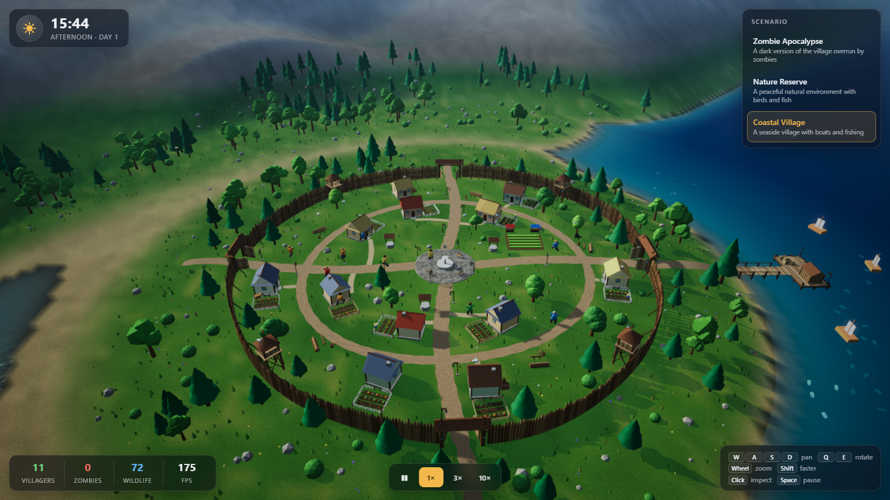
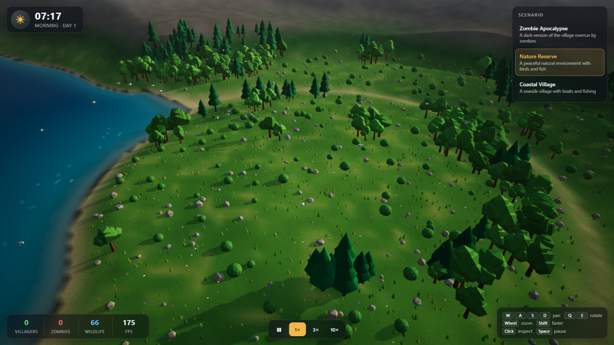
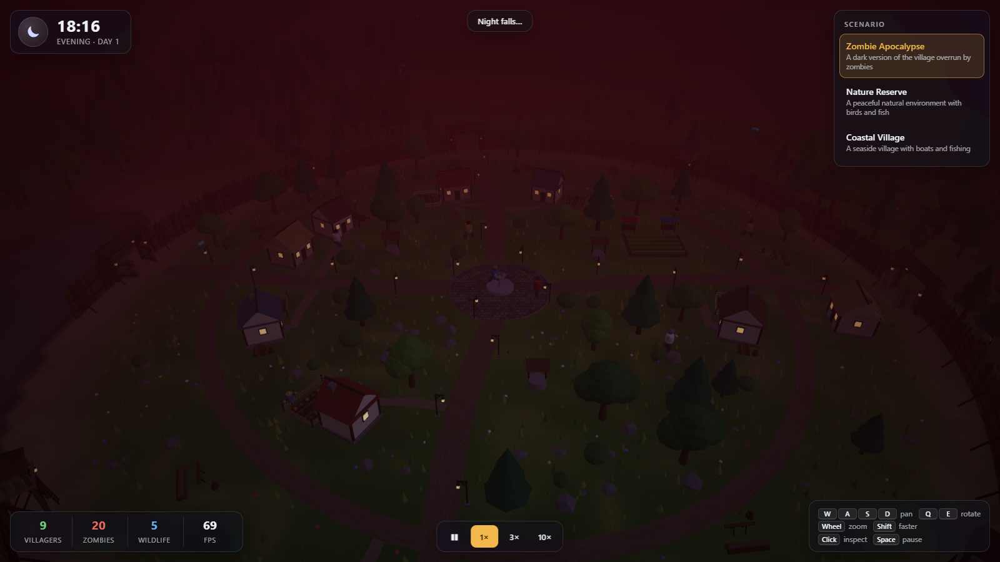

# Village Simulation

A low-poly 3D village simulation running in the browser, built with Babylon.js and Havok physics on a
TypeScript entity-component-system. Villagers follow daily schedules, farm, fish and sleep through a
full day/night cycle, while wildlife roams and zombies threaten after dark.



## Scenarios

| | |
|---|---|
|  |  |
| **Nature Reserve**: a peaceful landscape with birds and fish | **Zombie Apocalypse**: a dark version of the village overrun by zombies |

**Coastal Village** (top): a palisaded seaside village with a pier, boats and fishing.

## Run

```bash
cd ecs-rebuild
pnpm install
pnpm dev          # http://localhost:5173
```

Babylon.js and Havok load from a CDN, so you need a network connection. See
[ecs-rebuild/README.md](ecs-rebuild/README.md) for controls, project layout and tests.
