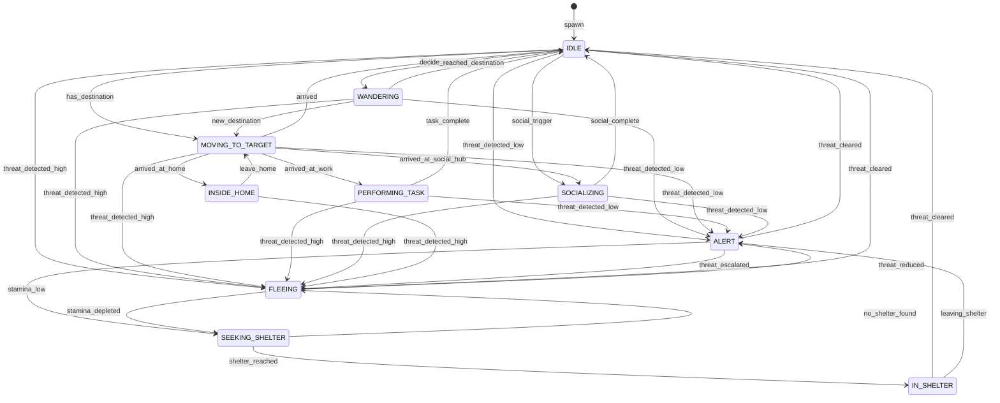

# Villager Mechanics

## Purpose

This document defines the complete behavioral specification for villager agents, including their state machine, schedule rules, social network interactions, and threat response systems.

## Boundaries

- **In Scope**: Villager states, transitions, schedule-based behavior, social interactions, survival instincts, shelter-seeking
- **Out of Scope**: Rendering details (see Art Docs), physics implementation (see physics-system.md)

## State Model

### State Diagram



### States

| State | Description | Entry Condition | Exit Condition |
|-------|-------------|-----------------|----------------|
| IDLE | Standing still, no active task | Default state, task complete | Decision timer expires |
| WANDERING | Moving randomly within area | No specific destination | Destination reached or interrupted |
| MOVING_TO_TARGET | Moving to specific destination | Has destination (work, home, social) | Arrival at destination |
| PERFORMING_TASK | Working at a work location | Arrived at work location | Task duration complete |
| SOCIALIZING | Interacting with other villagers | At social hub with others | Social timer expires |
| INSIDE_HOME | Hidden inside home (nighttime) | Arrived at home during night | Morning schedule trigger |
| ALERT | Heightened awareness, cautious | Low-moderate threat detected | Threat cleared or escalated |
| FLEEING | Running away from threat | High threat or panic level | Threat cleared or stamina depleted |
| SEEKING_SHELTER | Moving toward safe location | Stamina low while threatened | Shelter reached or unavailable |
| IN_SHELTER | Inside shelter, recovering | Shelter reached | Threat cleared |

## Schedule Rules

Villager behavior is governed by a time-of-day schedule based on the game clock.

### Daily Schedule

| Time Period | Hours | Primary Behavior | Allowed States |
|-------------|-------|------------------|----------------|
| Night | 22:00 - 06:00 | Sleep at home | INSIDE_HOME, FLEEING |
| Morning | 06:00 - 09:00 | Wake up, leave home | IDLE, WANDERING, SOCIALIZING |
| Daytime | 09:00 - 17:00 | Work (70%) or wander (30%) | PERFORMING_TASK, WANDERING, MOVING_TO_TARGET |
| Evening | 17:00 - 22:00 | Socialize (60%) or wander (40%) | SOCIALIZING, WANDERING, IDLE |

### Schedule Semantics (Normative Guarantees)

- Villagers MUST check the game clock when deciding next action
- Villagers MUST return home when night begins (22:00)
- Villagers MUST leave home when morning begins (06:00)
- Schedule decisions MUST be overridden by threat response

## Social Network System

### Relationship Model

Each villager maintains relationships with other villagers:

| Attribute | Range | Description |
|-----------|-------|-------------|
| strength | 0.0 - 1.0 | Overall relationship strength |
| trust | 0.0 - 1.0 | Willingness to share information |
| respect | 0.0 - 1.0 | Deference in group decisions |
| affection | 0.0 - 1.0 | Emotional bond |
| cooperation | 0.0 - 1.0 | Willingness to help |

### Relationship Types

| Type | Strength Threshold | Behaviors Unlocked |
|------|-------------------|-------------------|
| distant | < 0.2 | Basic greetings only |
| neutral | 0.2 - 0.4 | Small talk |
| acquaintance | 0.4 - 0.6 | Information sharing |
| friend | 0.6 - 0.8 | Personal sharing, favor requests |
| close_friend | > 0.8 | Deep conversation, emotional support |

### Social Interactions

| Interaction | Relationship Requirement | Effect |
|-------------|-------------------------|--------|
| greeting | None | +0.005 strength, +0.01 affection |
| small_talk | None | +0.01 strength, +0.005 cooperation |
| information_sharing | strength > 0.3 | +0.02 trust, +0.01 cooperation |
| personal_sharing | strength > 0.5 | +0.03 strength, +0.02 trust, +0.02 affection |
| favor_request | strength > 0.5 | Variable based on trust |
| deep_conversation | strength > 0.7 | +0.04 strength, +0.03 trust, +0.02 respect |
| emotional_support | strength > 0.7 | +0.04 trust, +0.03 affection |

### Personality Traits

Each villager has personality traits that affect social behavior:

| Trait | Range | Effect |
|-------|-------|--------|
| extroversion | 0.3 - 0.7 | Frequency of social interactions |
| agreeableness | 0.4 - 0.8 | Cooperation and resource sharing |
| conscientiousness | 0.3 - 0.8 | Work dedication, trustworthiness |
| neuroticism | 0.2 - 0.6 | Panic threshold, stress response |
| empathy | 0.4 - 0.8 | Emotional support effectiveness |
| assertiveness | 0.2 - 0.8 | Leadership potential |

### Social Network Semantics (Normative Guarantees)

- Relationships MUST decay over time without interaction
- Relationship strength MUST NOT exceed 1.0 or fall below 0.0
- Social interactions MUST require proximity (within social range)
- Information shared MUST propagate through trust network

## Threat Response System

### Survival Instinct

The survival instinct system manages threat detection and response:

| Parameter | Default | Description |
|-----------|---------|-------------|
| threatDetectionRange | 25 units | Distance at which threats are detected |
| panicThreshold | 0.7 | Panic level triggering flee response |
| escapeSpeed | 0.08 | Movement speed when fleeing |
| groupWarningRange | 15 units | Range for warning other villagers |
| memoryDuration | 20 seconds | How long threats are remembered |
| courageLevel | 0.3 | Resistance to panic (0-1) |
| staminaMax | 100 | Maximum stamina for fleeing |

### Threat Assessment

Threat level is calculated from multiple factors:

```
threatLevel = baseThreat × distanceFactor × losFactor × stateFactor × groupFactor
```

| Factor | Calculation |
|--------|-------------|
| baseThreat | 0.8 for zombies, 0.1 for unknown agents |
| distanceFactor | 1 - (distance / detectionRange) |
| losFactor | 1.0 if visible, 0.3 if obscured |
| stateFactor | 1.5 if pursuing, 0.7 if idle |
| groupFactor | 1.0 + (groupSize - 1) × 0.2 |

### Panic Response

| Panic Level | Response |
|-------------|----------|
| < 0.2 | Normal behavior |
| 0.2 - 0.4 | Increased vigilance |
| 0.4 - 0.7 | ALERT state, cautious movement |
| > 0.7 | FLEEING state, escape behavior |

### Escape Behavior

1. Calculate escape direction (away from threat)
2. Find safe zone if available
3. Move at escape speed
4. Drain stamina while fleeing
5. If stamina depleted, seek shelter
6. Broadcast warning to nearby villagers

### Threat Response Semantics (Normative Guarantees)

- Villagers MUST detect threats within detection range
- Villagers MUST transition to ALERT when threat level > 0.3
- Villagers MUST transition to FLEEING when panic level > panicThreshold
- Villagers MUST warn nearby villagers when threat detected
- Stamina MUST drain while fleeing and regenerate while safe

## Shelter System

### Shelter Types

| Type | Capacity | Safety Score | Accessibility |
|------|----------|--------------|---------------|
| safe_zone | 10 | 0.9 | High |
| building | 4-8 | 0.7 | Medium |
| natural_elevated | 6 | 0.6 | Medium |
| natural_concealed | 3 | 0.4 | Low |

### Shelter Selection

Shelter score is calculated as:

```
score = (safety × 0.4) + (accessibility × 0.3) + (capacityScore × 0.2) + (maintenanceLevel × 0.1)
```

### Shelter Roles

| Role | Responsibility | Requirements |
|------|---------------|--------------|
| occupant | Basic shelter use | None |
| organizer | Coordinate shelter activities | Leadership > 0.5 |
| builder | Improve shelter condition | Building skill > 0.6 |
| guard | Protect shelter entrance | Assertiveness > 0.7, courage > 0.6 |

### Shelter Semantics (Normative Guarantees)

- Villagers MUST seek shelter when stamina depleted during threat
- Shelter capacity MUST NOT be exceeded (with 20% buffer)
- Villagers MUST contribute resources based on agreeableness
- Villagers MUST exit shelter when threat level < 0.1

## Points of Interest

### POI Types

| Type | Purpose | Capacity | Duration |
|------|---------|----------|----------|
| social_hub | Socializing | 8-10 | 1-4 minutes |
| work_location | Performing tasks | 5 | 60 seconds |
| home | Sleeping, recovery | 1 | Night hours |

### POI Assignment

- Each villager MUST be assigned a home on creation
- Work locations are selected randomly when work behavior triggers
- Social hubs are selected randomly when social behavior triggers

## Animation Mappings

| State | Animation | Speed Ratio |
|-------|-----------|-------------|
| IDLE | idle | 1.0 |
| WANDERING | walk | 1.0 |
| MOVING_TO_TARGET | walk | 1.0 (0.7 when approaching) |
| PERFORMING_TASK | work | 1.0 |
| SOCIALIZING | idle / greet | 1.0 |
| INSIDE_HOME | none (hidden) | - |
| FLEEING | walk | 2.0 |
| SEEKING_SHELTER | walk | 1.0 |
| IN_SHELTER | idle | 1.0 |
| ALERT | idle | 1.0 |

## Correctness Properties

- **Property 10**: Agent Initialization Order - All three layers (Model, Behavior, Agent) MUST be initialized before first update
- **Property 11**: Agent Error Recovery - For any error during agent update, the agent MUST remain in a valid state

## Cross-References

- #[[file:docs/Code_Tech_Docs/subsystems/agent-system.md]]
- #[[file:docs/Code_Tech_Docs/patterns/state-machine.md]]
- #[[file:docs/Code_Tech_Docs/patterns/group-behavior.md]]
- #[[file:docs/Design_Docs/environment-systems/day-night-cycle.md]]
