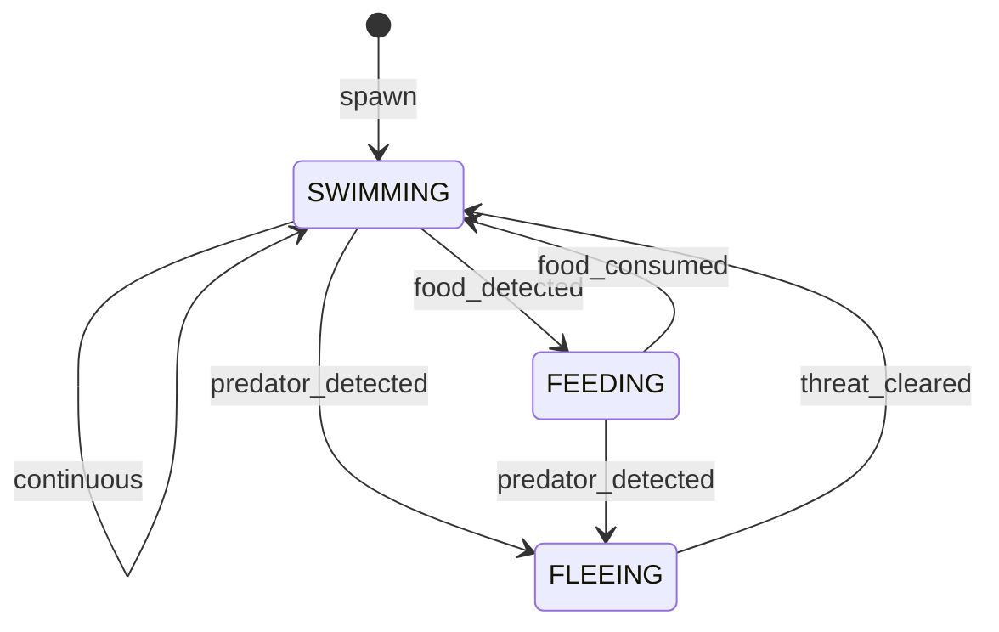
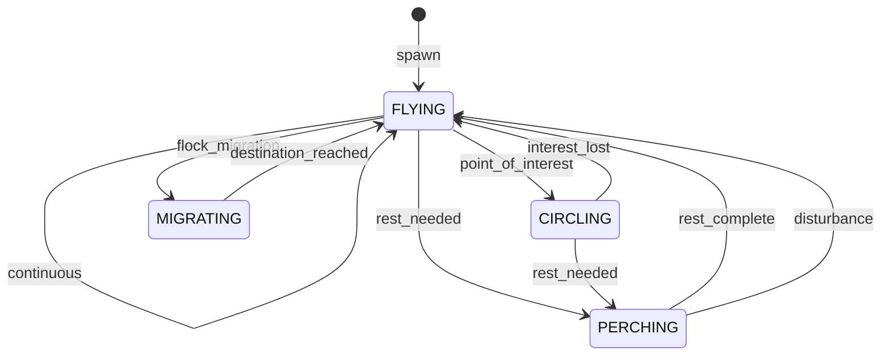
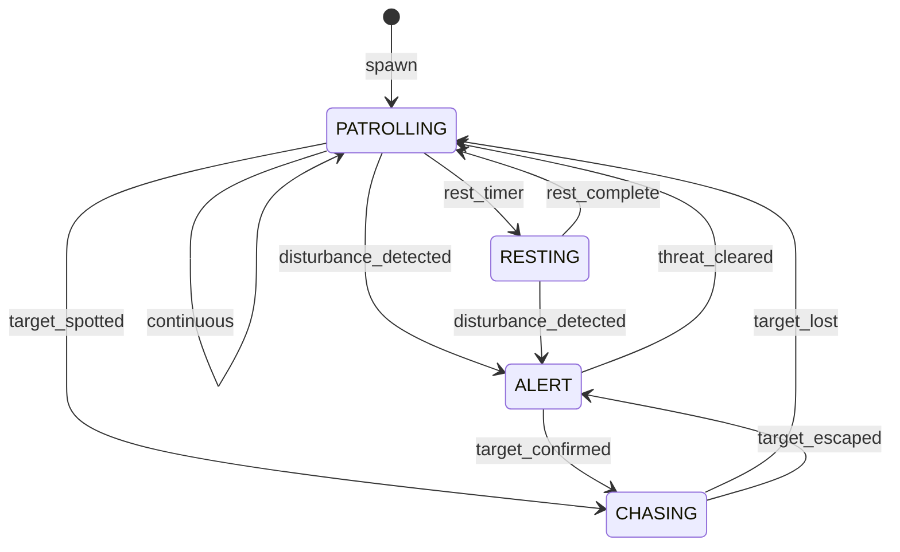
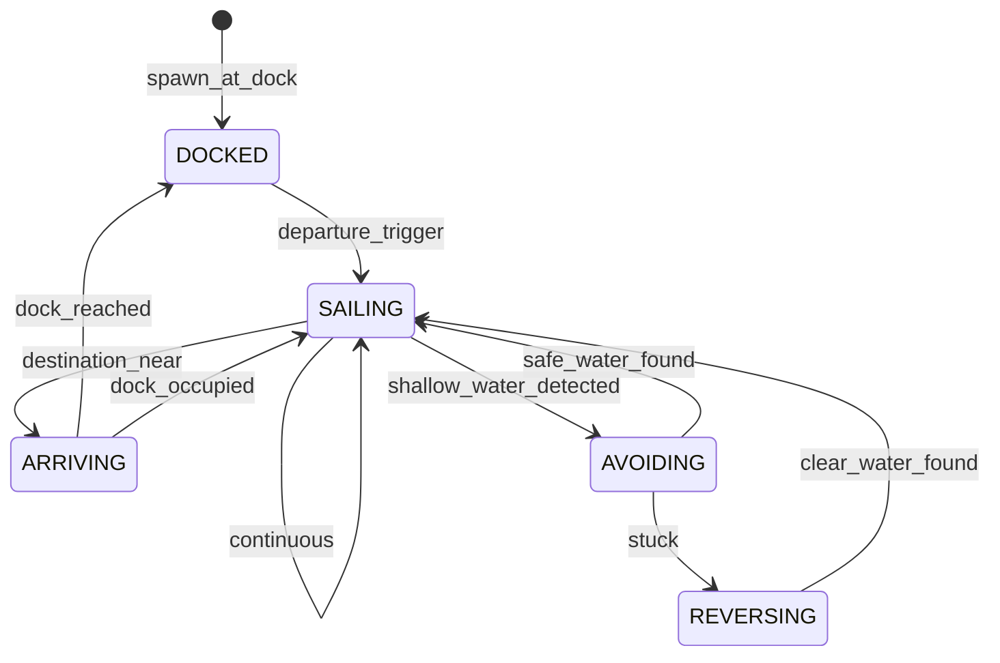

# Wildlife Mechanics

## Purpose

This document defines the complete behavioral specification for wildlife agents including fish, birds, dogs, and boats. Each agent type has unique movement domains and group behaviors.

## Boundaries

- **In Scope**: Wildlife states, transitions, movement domains, flocking/shoaling behaviors
- **Out of Scope**: Rendering details (see Art Docs), physics implementation (see physics-system.md)

---

## Fish Behavior

### Overview

Fish operate within a 3D water volume, exhibiting shoaling behavior with cohesion, separation, and alignment forces.

### Movement Domain

| Parameter | Default | Description |
|-----------|---------|-------------|
| schoolCenter | (0, -5, 0) | Center point of school |
| schoolRadius | 30 units | Maximum distance from center |
| minDepth | -15 units | Minimum swimming depth |
| maxDepth | -2 units | Maximum swimming depth (near surface) |

### State Diagram



### States

| State | Description | Entry Condition | Exit Condition |
|-------|-------------|-----------------|----------------|
| SWIMMING | Normal shoaling movement | Default state | Food or predator detected |
| FEEDING | Moving toward food source | Food detected | Food consumed |
| FLEEING | Rapid escape from predator | Predator detected | Threat cleared |

### Shoaling Forces

Fish movement combines four forces:

| Force | Weight | Description |
|-------|--------|-------------|
| Direction | 0.5 | Movement toward target position |
| Separation | 0.3 | Avoid crowding neighbors |
| Alignment | 0.1 | Match velocity of neighbors |
| Cohesion | 0.1 | Move toward group center |

### Separation Force

```
For each neighbor within 3 units:
    awayVector = (myPosition - neighborPosition).normalize()
    awayVector *= 1 / max(distance, 0.1)
    separation += awayVector
separation /= neighborCount
```

### Alignment Force

```
For each neighbor within 5 units:
    alignment += neighborVelocity
alignment /= neighborCount
alignment.normalize()
```

### Cohesion Force

```
For each neighbor within 10 units:
    center += neighborPosition
center /= neighborCount
cohesion = (center - myPosition).normalize()
```

### Fish Parameters

| Parameter | Default | Description |
|-----------|---------|-------------|
| speed | 0.05 - 0.10 | Individual swimming speed |
| targetUpdateInterval | 3-5 seconds | Time between new target selection |
| schoolCenterUpdateChance | 0.001 | Chance per frame to move school |

### Fish Semantics (Normative Guarantees)

- Fish MUST remain within water volume (minDepth to maxDepth)
- Fish MUST apply all three flocking forces each update
- Fish MUST face movement direction
- School center MUST remain within schoolRadius of origin

---

## Bird Behavior

### Overview

Birds operate in an air volume above the terrain, exhibiting flocking behavior with banking during turns.

### Movement Domain

| Parameter | Default | Description |
|-----------|---------|-------------|
| flockCenter | (0, 30, 0) | Center point of flock |
| flockRadius | 40 units | Maximum distance from center |
| minHeight | 20 units | Minimum flight altitude |
| maxHeight | 40 units | Maximum flight altitude |
| neighborhoodRadius | 15 units | Range for neighbor detection |

### State Diagram



### States

| State | Description | Entry Condition | Exit Condition |
|-------|-------------|-----------------|----------------|
| FLYING | Normal flocking movement | Default state | Interest or rest trigger |
| CIRCLING | Orbiting point of interest | Interesting location found | Interest lost |
| PERCHING | Resting on surface | Rest timer triggers | Rest complete or disturbed |
| MIGRATING | Long-distance group movement | Migration trigger | Destination reached |

### Flocking Forces

Bird movement combines four forces:

| Force | Weight | Description |
|-------|--------|-------------|
| Separation | 0.4 | Strong avoidance of neighbors |
| Alignment | 0.3 | Match flock direction |
| Cohesion | 0.2 | Stay with flock |
| Boundary | 0.5 | Stay within flight volume |

### Boundary Force

```
if position.y < minHeight:
    force.y += 1
else if position.y > maxHeight:
    force.y -= 1

distanceFromCenter = (flockCenter - position).length()
if distanceFromCenter > flockRadius:
    force += (flockCenter - position).normalize()
```

### Banking Behavior

Birds bank during turns for realistic flight:

```
bankAmount = clamp(velocity.cross(UP).length() * 2, -1, 1)
rotation.z = bankAmount * 0.3
```

### Bird Parameters

| Parameter | Default | Description |
|-----------|---------|-------------|
| speed | 0.2 - 0.3 | Individual flight speed |
| separationRadius | neighborhoodRadius × 0.5 | Distance for separation |
| flockCenterUpdateChance | 0.001 | Chance per frame to move flock |

### Bird Semantics (Normative Guarantees)

- Birds MUST remain within flight volume (minHeight to maxHeight)
- Birds MUST apply boundary force when approaching limits
- Birds MUST bank during turns
- Flock center MUST remain within flockRadius of origin

---

## Dog Behavior

### Overview

Dogs operate on the ground surface, exhibiting territorial wandering behavior with rest periods.

### Movement Domain

| Parameter | Default | Description |
|-----------|---------|-------------|
| wanderRadius | 30 units | Maximum distance from center |
| centerPoint | (0, 0, 0) | Territory center |
| terrainFollowing | true | Dogs follow terrain height |

### State Diagram



### States

| State | Description | Entry Condition | Exit Condition |
|-------|-------------|-----------------|----------------|
| PATROLLING | Wandering within territory | Default state | Rest or alert trigger |
| RESTING | Stationary rest period | Rest timer triggers | Rest duration complete |
| ALERT | Heightened awareness | Disturbance detected | Threat cleared or confirmed |
| CHASING | Pursuing target | Target spotted | Target lost or caught |

### Wandering Behavior

Dogs wander using angle-based navigation:

```
wanderAngle += random(-π/4, π/4)
targetX = currentX + cos(wanderAngle) × wanderRadius
targetZ = currentZ + sin(wanderAngle) × wanderRadius

if distanceFromCenter > wanderRadius:
    wanderAngle = atan2(-currentZ, -currentX)  // Head back to center
```

### Territory Rules

- Dogs MUST stay within wanderRadius of centerPoint
- If boundary exceeded, dog MUST turn toward center
- Dogs MUST follow terrain height

### Rest Behavior

| Parameter | Default | Description |
|-----------|---------|-------------|
| restDuration | 2-5 seconds | Time spent resting |
| restTrigger | Destination reached | When rest begins |

### Dog Parameters

| Parameter | Default | Description |
|-----------|---------|-------------|
| speed | Variable | Movement speed |
| wanderRadius | 5-15 units | Individual wander distance |
| physicsForce | 40 | Force applied for movement |

### Dog Semantics (Normative Guarantees)

- Dogs MUST remain within territory bounds
- Dogs MUST follow terrain height
- Dogs MUST rest after reaching destination
- Dogs MUST face movement direction

---

## Boat Behavior

### Overview

Boats operate on the water surface, navigating while avoiding shallow water and terrain.

### Movement Domain

| Parameter | Default | Description |
|-----------|---------|-------------|
| waterLevel | Variable | Y-coordinate of water surface |
| safeRadius | 30 units | Safe navigation area |
| minWaterDepth | 3 units | Minimum depth for navigation |
| terrainCheckDistance | 8 units | Distance to check for obstacles |

### State Diagram



### States

| State | Description | Entry Condition | Exit Condition |
|-------|-------------|-----------------|----------------|
| DOCKED | Stationary at dock | At dock location | Departure trigger |
| SAILING | Normal water navigation | Departure or safe water | Destination or obstacle |
| ARRIVING | Approaching destination | Near destination | Dock reached |
| AVOIDING | Steering away from shallow | Shallow water detected | Safe water found |
| REVERSING | Backing away from danger | Stuck in shallow | Clear water found |

### Water Depth Calculation

```
waterDepth = waterLevel - terrainHeight(x, z)
isSafeWater = waterDepth >= minWaterDepth
```

### Terrain Avoidance

Boats check multiple directions for safe water:

```
checkPoints = [
    { direction: forward, weight: 1.0 },
    { direction: forward + 45°, weight: 0.7 },
    { direction: forward - 45°, weight: 0.7 }
]

For each checkPoint:
    checkPos = position + direction × terrainCheckDistance
    depth = getWaterDepth(checkPos)
    if depth < minWaterDepth:
        avoidanceVector += (position - checkPos).normalize() × weight × (minWaterDepth - depth)
```

### Deep Water Finding

When stuck, boats search for deeper water:

```
For angle in [0, π/4, π/2, 3π/4, π, 5π/4, 3π/2, 7π/4]:
    checkDir = (sin(angle), 0, cos(angle))
    checkPos = position + checkDir × terrainCheckDistance
    depth = getWaterDepth(checkPos)
    if depth > maxDepth:
        maxDepth = depth
        deepestDirection = checkDir
```

### Visual Effects

Boats have wave-based visual motion:

| Effect | Formula | Description |
|--------|---------|-------------|
| Vertical bob | sin(time + x × 0.2) × waveHeight | Up/down motion |
| Roll | sin(time + x × 0.2) × tiltAmount | Side-to-side tilt |
| Pitch | cos(time + z × 0.2) × tiltAmount | Front-back tilt |

### Boat Parameters

| Parameter | Default | Description |
|-----------|---------|-------------|
| speed | 0.03 | Navigation speed |
| turnSpeed | 0.01 | Rotation speed |
| waveHeight | 0.1 | Vertical wave amplitude |
| tiltAmount | 0.05 | Roll/pitch amplitude |
| minDistToOthers | 10 units | Collision avoidance distance |
| avoidanceStrength | 2.0 | Obstacle avoidance force |

### Boat Semantics (Normative Guarantees)

- Boats MUST remain on water surface
- Boats MUST avoid water depth < minWaterDepth
- Boats MUST reverse when stuck in shallow water
- Boats MUST apply wave motion effects
- Boats MUST stay within safeRadius of center

---

## Common Flocking Algorithm

All flocking agents (fish, birds) use the same core algorithm with different parameters:

### Force Calculation

```
totalForce = Vector3.Zero()

// Separation: avoid crowding
for each neighbor within separationRadius:
    awayVector = (myPosition - neighborPosition).normalize()
    awayVector *= 1 / max(distance, 0.1)
    totalForce += awayVector × separationWeight

// Alignment: match velocity
for each neighbor within alignmentRadius:
    totalForce += neighborVelocity
totalForce /= neighborCount
totalForce.normalize()
totalForce *= alignmentWeight

// Cohesion: move toward center
center = average(neighborPositions)
cohesionVector = (center - myPosition).normalize()
totalForce += cohesionVector × cohesionWeight

// Apply force to velocity
velocity += totalForce × deltaTime
velocity = clamp(velocity.length(), 0, maxSpeed)
```

### Parameter Comparison

| Parameter | Fish | Bird |
|-----------|------|------|
| Separation Weight | 0.3 | 0.4 |
| Alignment Weight | 0.1 | 0.3 |
| Cohesion Weight | 0.1 | 0.2 |
| Separation Radius | 3 units | 7.5 units |
| Alignment Radius | 5 units | 15 units |
| Cohesion Radius | 10 units | 15 units |

## Correctness Properties

- **Property 9**: Group Force Composition - For any agent in a group, the steering force MUST include cohesion, separation, and alignment components
- **Property 10**: Agent Initialization Order - All three layers (Model, Behavior, Agent) MUST be initialized before first update
- **Property 11**: Agent Error Recovery - For any error during agent update, the agent MUST remain in a valid state

## Cross-References

- #[[file:docs/Code_Tech_Docs/subsystems/agent-system.md]]
- #[[file:docs/Code_Tech_Docs/patterns/group-behavior.md]]
- #[[file:docs/Design_Docs/environment-systems/water-system.md]]
- #[[file:docs/Code_Tech_Docs/subsystems/physics-system.md]]
