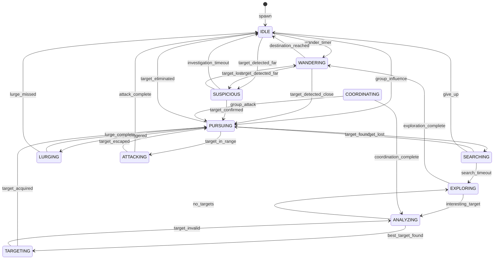

# Zombie Mechanics

## Purpose

This document defines the complete behavioral specification for zombie agents, including their state machine, awareness system, pursuit mechanics, lurge behavior, and group coordination.

## Boundaries

- **In Scope**: Zombie states, transitions, detection, pursuit, lurge mechanics, group behavior, intelligence system
- **Out of Scope**: Rendering details (see Art Docs), physics implementation (see physics-system.md)

## State Model

### State Diagram



### States

| State | Description | Entry Condition | Exit Condition |
|-------|-------------|-----------------|----------------|
| IDLE | Standing still, minimal activity | Default, post-attack | Wander timer or detection |
| WANDERING | Shambling randomly | No target, wander timer | Destination reached or detection |
| SUSPICIOUS | Investigating potential target | Target detected at distance | Confirmation or timeout |
| PURSUING | Actively chasing target | Target confirmed | Target reached, lost, or lurge |
| SEARCHING | Looking for lost target | Target lost during pursuit | Target found or timeout |
| EXPLORING | Wandering with heightened awareness | Search timeout | Interesting target found |
| ANALYZING | Evaluating potential targets | Intelligence system active | Best target selected |
| TARGETING | Locking onto specific target | Target prioritized | Target acquired |
| LURGING | Sudden burst of speed | Random chance during pursuit | Lurge duration complete |
| ATTACKING | Engaging target at close range | Target within attack range | Attack complete |
| COORDINATING | Working with group | Group formation active | Coordination complete |

## Awareness System

### Detection Parameters

| Parameter | Default | Description |
|-----------|---------|-------------|
| playerAwarenessRadius | 40 units | Distance for initial detection |
| aggressiveRadius | 30 units | Distance for aggressive pursuit |
| memoryDuration | 30 seconds | How long targets are remembered |
| targetSwitchCooldown | 2 seconds | Minimum time between target changes |

### Detection Factors

Target priority is calculated from multiple factors:

```
priority = (distanceFactor × 0.3) + (healthFactor × 0.2) + (threatFactor × 0.2) + (memoryFactor × 0.2) + (losFactor × 0.1)
```

| Factor | Calculation |
|--------|-------------|
| distanceFactor | 1 - (distance / 50) |
| healthFactor | 1 - (targetHealth / 100) |
| threatFactor | targetThreatLevel × aggressionLevel |
| memoryFactor | min(encounters / 10, 0.2) |
| losFactor | 1.0 if visible, 0.0 if obscured |

### Target Memory

Zombies maintain memory of encountered targets:

| Memory Attribute | Description |
|-----------------|-------------|
| firstSeen | Timestamp of first encounter |
| lastSeen | Timestamp of most recent sighting |
| encounters | Number of times encountered |
| lastKnownPosition | Last observed position |
| behavior | Learned behavior pattern (mobile/stationary) |
| movementPattern | Recent movement directions and speeds |

### Awareness Semantics (Normative Guarantees)

- Zombies MUST detect targets within awareness radius
- Zombies MUST transition to SUSPICIOUS when target detected at distance
- Zombies MUST transition to PURSUING when target within aggressive radius
- Target memory MUST decay after memoryDuration expires
- Zombies MUST NOT switch targets more frequently than targetSwitchCooldown

## Pursuit Mechanics

### Pursuit Strategy

The intelligence system calculates pursuit strategy based on:

| Strategy | Condition | Behavior |
|----------|-----------|----------|
| direct | Default | Move straight toward target |
| intercept | Target is mobile | Predict target position |
| cautious | Environmental threat | Slower approach |
| coordinated | Group present | Coordinate with group |

### Speed Parameters

| Parameter | Default | Description |
|-----------|---------|-------------|
| minSpeed | 0.02 | Minimum movement speed |
| maxSpeed | 0.05 | Maximum normal speed |
| lurgeSpeedMultiplier | 4.0 | Speed multiplier during lurge |

### Pursuit Semantics (Normative Guarantees)

- Zombies MUST move toward target position during PURSUING state
- Zombies MUST update target position each frame
- Zombies MUST transition to SEARCHING if target not visible for 5 seconds
- Zombies MUST attack when within 3 units of target

## Lurge Mechanics

### Lurge Behavior

The lurge is a sudden burst of speed that makes zombies unpredictable:

| Parameter | Default | Description |
|-----------|---------|-------------|
| lurgeChance | 0.02 (2%) | Chance per frame during pursuit |
| lurgeDuration | 1.0 second | Duration of speed burst |
| lurgeSpeedMultiplier | 4.0 | Speed increase during lurge |

### Lurge Trigger Conditions

- Zombie MUST be in PURSUING state
- Random chance check passes (2% per frame)
- Target MUST be within 20 units

### Lurge Semantics (Normative Guarantees)

- Lurge MUST multiply speed by lurgeSpeedMultiplier
- Lurge MUST last exactly lurgeDuration seconds
- Zombie MUST return to normal speed after lurge
- Lurge direction MUST be toward target position at trigger time

## Group Behavior

### Group Formation

Zombies naturally form groups based on proximity:

| Parameter | Default | Description |
|-----------|---------|-------------|
| maxGroupSize | 6 | Maximum zombies per group |
| minGroupSize | 2 | Minimum for group formation |
| formationRadius | 8 units | Spacing within formation |
| coordinationRange | 25 units | Range for group coordination |

### Group Roles

| Role | Max Count | Responsibilities | Bonuses |
|------|-----------|-----------------|---------|
| leader | 1 | Navigation, decision-making | +0.2 aggression, +0.3 detection |
| scout | 2 | Reconnaissance, target spotting | +0.3 speed, +0.5 detection |
| flanker | 2 | Flanking, cutting off escape | +0.2 speed, +0.3 stealth |
| bruiser | 2 | Direct assault, intimidation | +0.4 aggression, +0.3 persistence |
| follower | ∞ | Support, backup | +0.2 coordination |

### Formation Patterns

| Pattern | Description | Use Case |
|---------|-------------|----------|
| line | Single file | Narrow passages |
| wedge | V-shape with leader at front | Open pursuit |
| circle | Surrounding formation | Cornering target |
| swarm | Random clustering | General movement |
| pincer | Two flanking groups | Coordinated attack |

### Group Cohesion

Group cohesion is calculated from member positions:

```
cohesion = 1.0 - max(0, (averageDistance - idealDistance) / idealDistance)
```

### Group Influence

Zombies influence each other's behavior:

- If one zombie is PURSUING, nearby idle zombies have 3% chance per second to join
- Group members share target information
- Leaders broadcast formation commands

### Group Semantics (Normative Guarantees)

- Groups MUST maintain cohesion distance
- Groups MUST NOT exceed maxGroupSize
- Leader MUST be assigned when group forms
- Roles MUST be reassigned if leader is eliminated
- Group MUST disband if size falls below minGroupSize

## Intelligence System

### Adaptation Parameters

| Parameter | Default | Description |
|-----------|---------|-------------|
| adaptationRate | 0.1 | Speed of behavioral adaptation |
| learningEnabled | true | Whether learning is active |
| aggressionLevel | 0.5 | Base aggression (0-1) |
| curiosityLevel | 0.3 | Exploration tendency (0-1) |
| persistenceLevel | 0.7 | Target pursuit persistence (0-1) |

### Learning System

Zombies learn from successes and failures:

| Event | Effect |
|-------|--------|
| target_reached | +1 success, increase aggression |
| target_lost | +1 failure, decrease persistence |
| target_found_during_search | +1 success, increase curiosity |
| target_invalid | +1 failure, update memory |

### Adaptation Behavior

```
successRate = successes / (successes + failures)

if successRate > 0.7:
    aggressionLevel += adaptationRate × deltaTime
else if successRate < 0.3:
    aggressionLevel -= adaptationRate × deltaTime
```

### Intelligence Semantics (Normative Guarantees)

- Intelligence MUST track success and failure events
- Adaptation MUST adjust behavior parameters over time
- Memory MUST be cleaned up after memoryDuration
- Learning MUST NOT cause parameters to exceed bounds (0-1)

## Pathfinding

### Pathfinding Parameters

| Parameter | Default | Description |
|-----------|---------|-------------|
| gridSize | 2 units | Navigation grid cell size |
| crowdAvoidanceRadius | 5 units | Distance to avoid other zombies |
| dynamicReplanning | true | Replan when obstacles detected |
| maxPathLength | 100 nodes | Maximum path complexity |

### Pathfinding Behavior

1. Calculate path to target using A* algorithm
2. Apply crowd avoidance to prevent clumping
3. Replan if path becomes blocked
4. Fall back to direct movement if pathfinding fails

### Pathfinding Semantics (Normative Guarantees)

- Pathfinding MUST find valid path if one exists
- Pathfinding MUST avoid static obstacles
- Crowd avoidance MUST prevent zombie overlap
- Path MUST be recalculated when target moves significantly

## Animation Mappings

| State | Animation | Speed Ratio |
|-------|-----------|-------------|
| IDLE | idle | 1.0 |
| WANDERING | shamble | 1.0 |
| SUSPICIOUS | idle_alert | 1.0 |
| PURSUING | walk | 1.5 |
| SEARCHING | walk | 1.0 |
| LURGING | run | 2.0 |
| ATTACKING | attack | 1.0 |

## Shamble Effect

Zombies have a characteristic shambling movement:

| Parameter | Range | Description |
|-----------|-------|-------------|
| swayAmount | 0.2 - 0.4 | Side-to-side movement amplitude |
| swayFrequency | Variable | Speed of swaying motion |

## Correctness Properties

- **Property 10**: Agent Initialization Order - All three layers (Model, Behavior, Agent) MUST be initialized before first update
- **Property 11**: Agent Error Recovery - For any error during agent update, the agent MUST remain in a valid state

## Cross-References

- #[[file:docs/Code_Tech_Docs/subsystems/agent-system.md]]
- #[[file:docs/Code_Tech_Docs/patterns/state-machine.md]]
- #[[file:docs/Code_Tech_Docs/patterns/group-behavior.md]]
- #[[file:docs/Design_Docs/agent-behaviors/villager-mechanics.md]]
